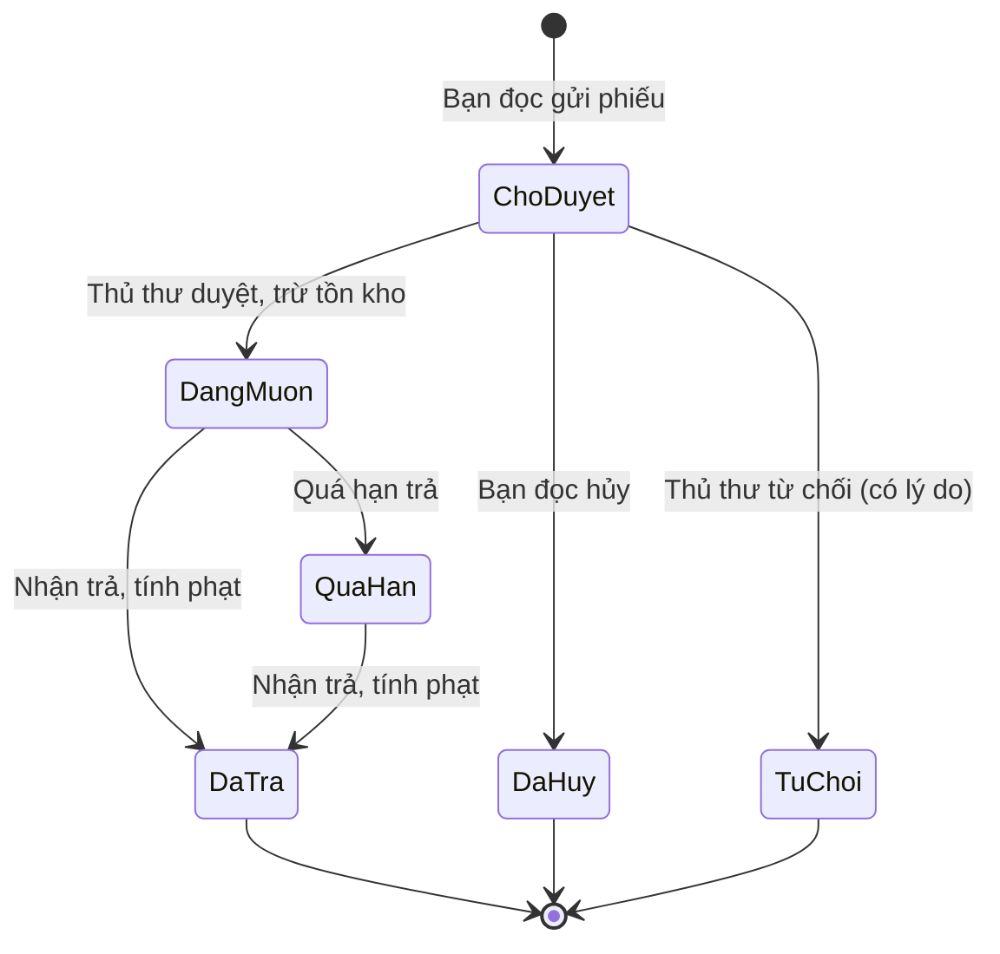
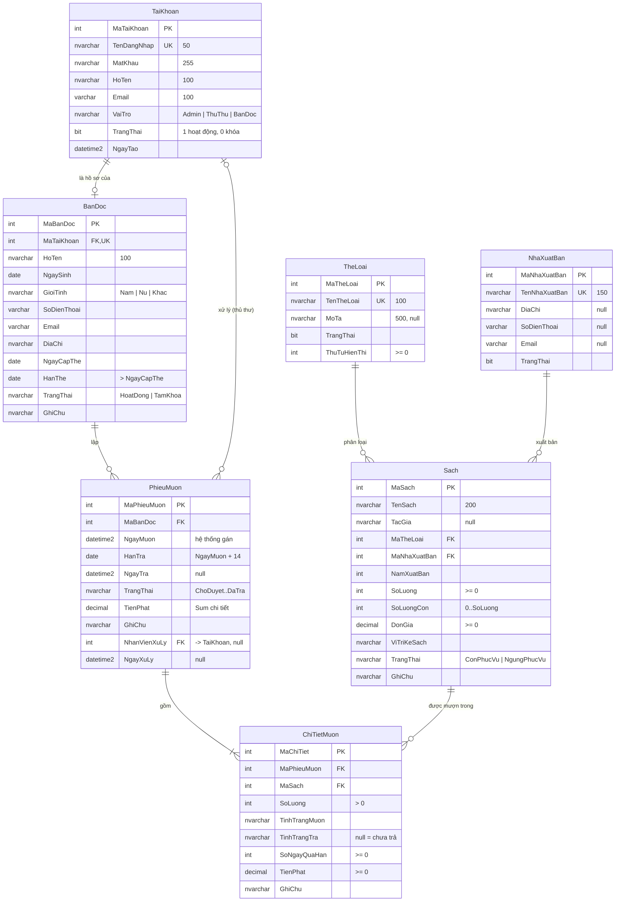
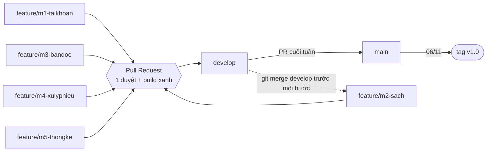

# Hệ thống Quản lý Thư viện và Mượn trả sách

**Đề tài 14** – Bài tập lớn môn Thực hành lập trình .NET · Nhóm 01 · Lớp DHTI17A4HN

Hệ thống quản lý toàn bộ quy trình của thư viện: dữ liệu nền (thể loại, nhà xuất bản, sách), bạn đọc, đăng ký mượn, duyệt phiếu, trả sách, tính tiền phạt, xử lý quá hạn, Dashboard và thống kê. Kiến trúc 3 lớp **Controller → Service → Repository**.

> **Bấm vào từng mục bên dưới để mở nội dung.** Thành viên mới đọc trước: [docs/LO_TRINH_TRIEN_KHAI.md](./docs/LO_TRINH_TRIEN_KHAI.md).

## Thành viên & phân công

| Mã | Họ tên | MSSV | Module | Nhánh |
|---|---|---|---|---|
| SV1 | Nguyễn Thế Đông (**Nhóm trưởng**) | 23103100187 | M1 – Tài khoản, đăng nhập, phân quyền, thể loại | `feature/m1-taikhoan` |
| SV2 | Trần Gia Nghĩa  | 23103100228 | M2 – Sách, nhà xuất bản, tìm kiếm / lọc , sắp xếp , phân trang | `feature/m2-sach` |
| SV3 | Đặng Thị Phượng | 23103100182 | M3 – Bạn đọc, hồ sơ cá nhân, đăng ký mượn, theo dõi phiếu | `feature/m3-bandoc` |
| SV4 | Trịnh Thị Thanh Tâm | 23103100193 | M4 – Duyệt phiếu, trả sách, tính phạt, luồng trạng thái | `feature/m4-xulyphieu` |
| SV5 | Phan Vũ Thanh Thư | 23103100316 | M5 – Chi tiết mượn, quá hạn, Dashboard, thống kê | `feature/m5-thongke` |

## Nội dung chi tiết

<details>
<summary><b>1. Công nghệ, chức năng theo vai trò, luồng trạng thái</b></summary>

| Hạng mục | Công nghệ |
|---|---|
| Nền tảng | ASP.NET Core 10 MVC (.NET 10), solution `.slnx` |
| Truy cập dữ liệu | Entity Framework Core 10.0.9 – Code First + Migration, LINQ |
| Cơ sở dữ liệu | SQL Server (Express / Developer / LocalDB) |
| Giao diện | Razor View, Bootstrap 5, Bootstrap Icons, Chart.js |
| Đăng nhập | Session + băm mật khẩu PBKDF2, `[Authorize(Roles = ...)]` |

| Vai trò | Chức năng |
|---|---|
| **Khách** | Trang chủ, tra cứu sách (tìm kiếm, lọc, sắp xếp, phân trang) |
| **Bạn đọc** | Giỏ mượn, đăng ký mượn, hủy phiếu chờ duyệt, theo dõi phiếu của mình, sửa hồ sơ, đổi mật khẩu |
| **Thủ thư** | Quản lý sách, NXB, bạn đọc · duyệt / từ chối phiếu · nhận trả sách, tính phạt · xử lý quá hạn · Dashboard, thống kê |
| **Admin** | Toàn bộ quyền Thủ thư + quản lý tài khoản nhân viên, thể loại |

Luồng trạng thái phiếu mượn:



</details>

<details>
<summary><b>2. Cấu trúc thư mục</b></summary>

```text
HE_THONG_QUAN_LY_THU_VIEN_VA_MUON_TRA_SACH/          ← thư mục gốc repo
├── .github/
│   ├── CODEOWNERS                      người duyệt bắt buộc theo module
│   └── workflows/build.yml             GitHub Actions tự build mỗi PR
├── docs/                               ERD, Use Case, thiết kế CSDL, database.sql, ảnh giao diện
├── .gitignore  .gitattributes  README.md
├── QuanLyThuVien_UNETI01_DHTI17A4HN.slnx
└── QuanLyThuVien_UNETI01_DHTI17A4HN/   ← project ASP.NET Core 10 MVC
    ├── Controllers/
    │   ├── Auth/  TaiKhoan/  TheLoai/                         (SV1)
    │   ├── Sach/  NhaXuatBan/  Home/                          (SV2)
    │   ├── BanDoc/  PhieuMuon/                                (SV3)
    │   ├── XuLyPhieu/                                         (SV4)
    │   └── ChiTietMuon/  QuaHan/  Dashboard/  ThongKe/        (SV5)
    ├── Services/
    │   ├── Common/ServiceResult.cs                            (SV1)
    │   ├── Auth/  TaiKhoan/  TheLoai/                         (SV1)
    │   ├── Sach/  NhaXuatBan/  TrangChu/                      (SV2)
    │   ├── BanDoc/  PhieuMuon/  MuonSach/                     (SV3)
    │   ├── XuLyPhieu/  NghiepVu/                              (SV4)
    │   └── ChiTietMuon/  QuaHan/  Dashboard/  ThongKe/        (SV5)
    ├── Repositories/
    │   ├── Common/IRepository.cs, Repository.cs               (SV1)
    │   ├── TaiKhoan/  TheLoai/                                (SV1)
    │   ├── Sach/  NhaXuatBan/                                 (SV2)
    │   ├── BanDoc/  PhieuMuon/                                (SV3)
    │   ├── XuLyPhieu/                                         (SV4)
    │   └── ChiTietMuon/                                       (SV5)
    ├── Data/            AppDbContext.cs, DbSeeder*.cs (partial theo module)
    ├── Helpers/         Session, mật khẩu, phân trang, giỏ mượn, DI, xác thực
    ├── Migrations/      do EF Core sinh – bắt buộc commit
    ├── Models/          7 Entity + QuyDinh.cs + Enums/Enums.cs
    ├── ViewModels/      dữ liệu cho View (mỗi module 1 file)
    ├── Views/           theo từng Controller + Shared
    ├── wwwroot/         css/site.css, lib/ (bootstrap, bootstrap-icons, chart.js, jquery)
    ├── appsettings.json chuỗi kết nối SQL Server
    └── Program.cs       cấu hình DI, Session, xác thực, Migration + dữ liệu mẫu
```

| Thư mục / file | Chứa gì | Phụ trách |
|---|---|---|
| `Controllers/<Module>/` | Nhận request, kiểm tra quyền `[Authorize]`, `ModelState`, gọi Service, trả View | Chủ module |
| `Services/<Module>/` | `IXxxService` + `XxxService`: luật nghiệp vụ, trả `ServiceResult` | Chủ module |
| `Services/NghiepVu/` | `TrangThaiPhieuService` (luồng trạng thái), `TinhPhatService` (công thức phạt) | SV4 |
| `Services/MuonSach/` | `MuonSachService`: kiểm tra điều kiện mượn, dùng chung SV3 + SV4 + SV5 | SV3 |
| `Repositories/Common/` | `IRepository<T>`, `Repository<T>`: truy vấn dùng chung | SV1 |
| `Repositories/<Module>/` | `IXxxRepository` + `XxxRepository`: LINQ tìm kiếm, lọc, sắp xếp, Include | Chủ module |
| `Data/AppDbContext.cs` | 7 DbSet, Fluent API (unique, check, enum lưu chuỗi, không xóa dây chuyền) | SV1 |
| `Data/DbSeeder*.cs` | Dữ liệu mẫu: `DbSeeder.cs` (SV1), `.Sach.cs` (SV2), `.BanDoc.cs` (SV3), `.PhieuMuon.cs` (SV5) | 4 người |
| `Helpers/` | `SessionHelper`, `MatKhauHelper`, `SessionAuthenticationHandler`, `Quyen`, `ServiceCollectionExtensions`, `ModelStateExtensions` (SV1) · `PhanTrang` (SV2) · `GioMuonHelper` (SV3) · `UiHelper` (SV4) | Theo file |
| `Models/` | `TaiKhoan`, `TheLoai` (SV1) · `NhaXuatBan`, `Sach` (SV2) · `BanDoc`, `PhieuMuon` (SV3) · `ChiTietMuon` (SV5) · `Enums`, `QuyDinh` (SV4) | Theo file |
| `Migrations/` | Migration `InitialCreate` – chỉ SV1 tạo | SV1 |
| `Program.cs`, `appsettings.json`, `.csproj`, `docs/`, `.github/` | Cấu hình chung, tài liệu, CI | SV1 |

Một chức năng đủ bộ = 5 file `.cs` + các View, ví dụ Nhà xuất bản: `INhaXuatBanRepository`, `NhaXuatBanRepository`, `INhaXuatBanService`, `NhaXuatBanService`, `NhaXuatBanController`, `Views/NhaXuatBan/*.cshtml`.

</details>

<details>
<summary><b>3. Sơ đồ ERD</b></summary>

 Ảnh tĩnh: [docs/images/erd.png](./docs/images/erd.png) · dán [docs/schema.dbml](./docs/schema.dbml) vào [dbdiagram.io](https://dbdiagram.io) 


| Quan hệ | Kiểu | Khóa ngoại | Khi xóa |
|---|---|---|---|
| TaiKhoan – BanDoc | 1 – 0..1 | `BanDoc.MaTaiKhoan` (UNIQUE) | Chặn (NO ACTION) |
| TaiKhoan – PhieuMuon | 1 – n | `PhieuMuon.NhanVienXuLy` (cho phép NULL) | Chặn |
| BanDoc – PhieuMuon | 1 – n | `PhieuMuon.MaBanDoc` | Chặn |
| TheLoai – Sach | 1 – n | `Sach.MaTheLoai` | Chặn – thể loại đã có sách chỉ được ngừng |
| NhaXuatBan – Sach | 1 – n | `Sach.MaNhaXuatBan` | Chặn |
| PhieuMuon – ChiTietMuon | 1 – n | `ChiTietMuon.MaPhieuMuon` | Chặn |
| Sach – ChiTietMuon | 1 – n | `ChiTietMuon.MaSach` | Chặn – sách đã có lịch sử chuyển Ngừng phục vụ |

`PhieuMuon` ↔ `Sach` là quan hệ **n – n**, tách qua bảng trung gian `ChiTietMuon` (UNIQUE `MaPhieuMuon` + `MaSach`).

</details>

<details>
<summary><b>4. Thiết kế cơ sở dữ liệu (7 bảng)</b></summary>

Database **QuanLyThuVien_UNETI01** – 7 bảng, tạo bằng Code First (Entity → `AppDbContext` → Migration `InitialCreate`). Mọi khóa ngoại `ON DELETE NO ACTION`; trạng thái lưu dạng chuỗi (enum C# + `HasConversion<string>()`).

#### `TaiKhoan` – SV1

| Cột | Kiểu | Null | Ràng buộc / ý nghĩa |
|---|---|---|---|
| MaTaiKhoan | int | Không | PK, IDENTITY |
| TenDangNhap | nvarchar(50) | Không | UNIQUE |
| MatKhau | nvarchar(255) | Không | Chuỗi băm PBKDF2 |
| HoTen | nvarchar(100) | Không |  |
| Email | varchar(100) | Không | `[EmailAddress]` |
| VaiTro | nvarchar(20) | Không | Admin / ThuThu / BanDoc |
| TrangThai | bit | Không | 1 = hoạt động, 0 = bị khóa |
| NgayTao | datetime2 | Không | DEFAULT SYSDATETIME() |
#### `TheLoai` – SV1

| Cột | Kiểu | Null | Ràng buộc / ý nghĩa |
|---|---|---|---|
| MaTheLoai | int | Không | PK, IDENTITY |
| TenTheLoai | nvarchar(100) | Không | UNIQUE |
| MoTa | nvarchar(500) | Có |  |
| TrangThai | bit | Không | 0 = ngừng, không hiện khi thêm sách |
| ThuTuHienThi | int | Không | CHECK ≥ 0 |
#### `NhaXuatBan` – SV2

| Cột | Kiểu | Null | Ràng buộc / ý nghĩa |
|---|---|---|---|
| MaNhaXuatBan | int | Không | PK, IDENTITY |
| TenNhaXuatBan | nvarchar(150) | Không | UNIQUE |
| DiaChi | nvarchar(255) | Có |  |
| SoDienThoai | varchar(15) | Có | `[Phone]` |
| Email | varchar(100) | Có | `[EmailAddress]` |
| TrangThai | bit | Không | 0 = ngừng hợp tác |
#### `Sach` – SV2

| Cột | Kiểu | Null | Ràng buộc / ý nghĩa |
|---|---|---|---|
| MaSach | int | Không | PK, IDENTITY |
| TenSach | nvarchar(200) | Không | INDEX (tìm kiếm) |
| TacGia | nvarchar(150) | Có |  |
| MaTheLoai | int | Không | FK → TheLoai |
| MaNhaXuatBan | int | Không | FK → NhaXuatBan |
| NamXuatBan | int | Không | CHECK 1900–2100; Service chặn > năm hiện tại |
| SoLuong | int | Không | CHECK ≥ 0 – tổng số cuốn |
| SoLuongCon | int | Không | CHECK 0 ≤ SoLuongCon ≤ SoLuong |
| DonGia | decimal(18,0) | Không | CHECK ≥ 0 (VNĐ) |
| ViTriKeSach | nvarchar(50) | Có | Ví dụ A2-03 |
| TrangThai | nvarchar(20) | Không | ConPhucVu / NgungPhucVu (xóa mềm) |
| GhiChu | nvarchar(500) | Có |  |
#### `BanDoc` – SV3

| Cột | Kiểu | Null | Ràng buộc / ý nghĩa |
|---|---|---|---|
| MaBanDoc | int | Không | PK, IDENTITY |
| MaTaiKhoan | int | Không | FK → TaiKhoan, UNIQUE |
| HoTen | nvarchar(100) | Không |  |
| NgaySinh | date | Có | Service chặn ≥ hôm nay |
| GioiTinh | nvarchar(10) | Có | Nam / Nu / Khac |
| SoDienThoai | varchar(15) | Có |  |
| Email | varchar(100) | Có |  |
| DiaChi | nvarchar(255) | Có |  |
| NgayCapThe | date | Không |  |
| HanThe | date | Không | CHECK HanThe > NgayCapThe |
| TrangThai | nvarchar(20) | Không | HoatDong / TamKhoa |
| GhiChu | nvarchar(500) | Có |  |
#### `PhieuMuon` – SV3 tạo, SV4 xử lý

| Cột | Kiểu | Null | Ràng buộc / ý nghĩa |
|---|---|---|---|
| MaPhieuMuon | int | Không | PK, IDENTITY |
| MaBanDoc | int | Không | FK → BanDoc, lấy từ Session |
| NgayMuon | datetime2 | Không | DEFAULT SYSDATETIME() |
| HanTra | date | Không | = ngày duyệt + 14 ngày |
| NgayTra | datetime2 | Có | CHECK NULL hoặc ≥ NgayMuon |
| TrangThai | nvarchar(20) | Không | ChoDuyet / DangMuon / QuaHan / DaTra / TuChoi / DaHuy |
| TienPhat | decimal(18,0) | Không | CHECK ≥ 0 = tổng tiền phạt các dòng chi tiết |
| GhiChu | nvarchar(500) | Có | Lý do từ chối / hủy |
| NhanVienXuLy | int | Có | FK → TaiKhoan |
| NgayXuLy | datetime2 | Có | Thời điểm duyệt / từ chối |
#### `ChiTietMuon` – SV5

| Cột | Kiểu | Null | Ràng buộc / ý nghĩa |
|---|---|---|---|
| MaChiTiet | int | Không | PK, IDENTITY |
| MaPhieuMuon | int | Không | FK → PhieuMuon |
| MaSach | int | Không | FK → Sach; UNIQUE (MaPhieuMuon, MaSach) |
| SoLuong | int | Không | CHECK > 0 |
| TinhTrangMuon | nvarchar(20) | Không | BinhThuong / CuNhung |
| TinhTrangTra | nvarchar(20) | Có | BinhThuong / HuHong / Mat; NULL = chưa trả |
| SoNgayQuaHan | int | Không | CHECK ≥ 0 |
| TienPhat | decimal(18,0) | Không | CHECK ≥ 0 |
| GhiChu | nvarchar(500) | Có |  |

#### Quy định nghiệp vụ (`Models/QuyDinh.cs`)

| Mã | Quy định | Giá trị |
|---|---|---|
| QD01 | Số ngày mượn, tính từ ngày duyệt | 14 ngày |
| QD02 | Số cuốn tối đa đang giữ | 5 cuốn |
| QD03 | Phạt quá hạn | 5.000 đ / ngày / cuốn |
| QD04 | Phạt sách hư hỏng | 50% đơn giá |
| QD05 | Phạt mất sách | 100% đơn giá, giảm `SoLuong` |
| QD09 | Đang có phiếu quá hạn | Không được mượn thêm |
| QD10 | Cảnh báo sắp đến hạn | Trước hạn 2 ngày |

```text
SoNgayQuaHan = max(0, NgayTra.Date - HanTra)
TienPhat     = SoNgayQuaHan × 5000 × SoLuong
             + (HuHong ? DonGia × 0.5 × SoLuong : 0)
             + (Mat    ? DonGia × 1.0 × SoLuong : 0)
PhieuMuon.TienPhat = tổng TienPhat các dòng ChiTietMuon
```

Chi tiết hơn: [docs/THIETKE_CSDL.md](./docs/THIETKE_CSDL.md).

</details>

<details>
<summary><b>5. Database hoàn chỉnh (script SQL)</b></summary>

Script đầy đủ: [docs/QuanLyThuVien_UNETI01_full.sql](./docs/QuanLyThuVien_UNETI01_full.sql) – tạo database, 7 bảng với đủ ràng buộc (sinh từ Migration `InitialCreate`), **232 dòng dữ liệu mẫu**, truy vấn kiểm tra. Mở trong SSMS → **Execute** (F5).

| Bảng | Số dòng mẫu | Ghi chú |
|---|---|---|
| TaiKhoan | 35 | 2 Admin, 3 Thủ thư, 30 Bạn đọc (`bandoc29` bị khóa) |
| TheLoai | 6 | 1 thể loại đã ngừng |
| NhaXuatBan | 5 |  |
| Sach | 20 | 2 sách ngừng phục vụ |
| BanDoc | 30 | `bandoc26`–`28` thẻ hết hạn, `bandoc30` thẻ tạm khóa |
| PhieuMuon | 52 | 24 đã trả, 10 đang mượn, 6 quá hạn, 5 chờ duyệt, 4 đã hủy, 3 từ chối |
| ChiTietMuon | 84 | Có dòng trả hư hỏng, mất sách kèm tiền phạt |

> Database của dự án vẫn tạo bằng **Code First** (`Update-Database` hoặc F5) theo yêu cầu đề bài. Script này dùng để đưa vào báo cáo, đối chiếu, hoặc tạo nhanh trên máy không chạy được Migration. Script ghi luôn vào `__EFMigrationsHistory` nên chạy web sau đó không tạo lại bảng.

<details>
<summary>Xem phần tạo database và bảng</summary>

```sql
-- =============================== 1. TẠO DATABASE ===============================
USE master;
GO
IF DB_ID(N'QuanLyThuVien_UNETI01') IS NOT NULL
BEGIN
    ALTER DATABASE [QuanLyThuVien_UNETI01] SET SINGLE_USER WITH ROLLBACK IMMEDIATE;
    DROP DATABASE [QuanLyThuVien_UNETI01];
END
GO
CREATE DATABASE [QuanLyThuVien_UNETI01];
GO
USE [QuanLyThuVien_UNETI01];
GO

-- =============================== 2. BẢNG, RÀNG BUỘC, INDEX ===============================
IF OBJECT_ID(N'[__EFMigrationsHistory]') IS NULL
BEGIN
    CREATE TABLE [__EFMigrationsHistory] (
        [MigrationId] nvarchar(150) NOT NULL,
        [ProductVersion] nvarchar(32) NOT NULL,
        CONSTRAINT [PK___EFMigrationsHistory] PRIMARY KEY ([MigrationId])
    );
END;
GO

BEGIN TRANSACTION;
CREATE TABLE [NhaXuatBan] (
    [MaNhaXuatBan] int NOT NULL IDENTITY,
    [TenNhaXuatBan] nvarchar(150) NOT NULL,
    [DiaChi] nvarchar(255) NULL,
    [SoDienThoai] varchar(15) NULL,
    [Email] varchar(100) NULL,
    [TrangThai] bit NOT NULL,
    CONSTRAINT [PK_NhaXuatBan] PRIMARY KEY ([MaNhaXuatBan])
);

CREATE TABLE [TaiKhoan] (
    [MaTaiKhoan] int NOT NULL IDENTITY,
    [TenDangNhap] nvarchar(50) NOT NULL,
    [MatKhau] nvarchar(255) NOT NULL,
    [HoTen] nvarchar(100) NOT NULL,
    [Email] varchar(100) NOT NULL,
    [VaiTro] nvarchar(20) NOT NULL,
    [TrangThai] bit NOT NULL,
    [NgayTao] datetime2 NOT NULL DEFAULT (SYSDATETIME()),
    CONSTRAINT [PK_TaiKhoan] PRIMARY KEY ([MaTaiKhoan])
);

CREATE TABLE [TheLoai] (
    [MaTheLoai] int NOT NULL IDENTITY,
    [TenTheLoai] nvarchar(100) NOT NULL,
    [MoTa] nvarchar(500) NULL,
    [TrangThai] bit NOT NULL,
    [ThuTuHienThi] int NOT NULL,
    CONSTRAINT [PK_TheLoai] PRIMARY KEY ([MaTheLoai]),
    CONSTRAINT [CK_TheLoai_ThuTu] CHECK ([ThuTuHienThi] >= 0)
);

CREATE TABLE [BanDoc] (
    [MaBanDoc] int NOT NULL IDENTITY,
    [MaTaiKhoan] int NOT NULL,
    [HoTen] nvarchar(100) NOT NULL,
    [NgaySinh] date NULL,
    [GioiTinh] nvarchar(10) NULL,
    [SoDienThoai] varchar(15) NULL,
    [Email] varchar(100) NULL,
    [DiaChi] nvarchar(255) NULL,
    [NgayCapThe] date NOT NULL,
    [HanThe] date NOT NULL,
    [TrangThai] nvarchar(20) NOT NULL,
    [GhiChu] nvarchar(500) NULL,
    CONSTRAINT [PK_BanDoc] PRIMARY KEY ([MaBanDoc]),
    CONSTRAINT [CK_BanDoc_HanThe] CHECK ([HanThe] > [NgayCapThe]),
    CONSTRAINT [FK_BanDoc_TaiKhoan_MaTaiKhoan] FOREIGN KEY ([MaTaiKhoan]) REFERENCES [TaiKhoan] ([MaTaiKhoan]) ON DELETE NO ACTION
);

CREATE TABLE [Sach] (
    [MaSach] int NOT NULL IDENTITY,
    [TenSach] nvarchar(200) NOT NULL,
    [TacGia] nvarchar(150) NULL,
    [MaTheLoai] int NOT NULL,
    [MaNhaXuatBan] int NOT NULL,
    [NamXuatBan] int NOT NULL,
    [SoLuong] int NOT NULL,
    [SoLuongCon] int NOT NULL,
    [DonGia] decimal(18,0) NOT NULL,
    [ViTriKeSach] nvarchar(50) NULL,
    [TrangThai] nvarchar(20) NOT NULL,
    [GhiChu] nvarchar(500) NULL,
    CONSTRAINT [PK_Sach] PRIMARY KEY ([MaSach]),
    CONSTRAINT [CK_Sach_DonGia] CHECK ([DonGia] >= 0),
    CONSTRAINT [CK_Sach_NamXuatBan] CHECK ([NamXuatBan] BETWEEN 1900 AND 2100),
    CONSTRAINT [CK_Sach_SoLuong] CHECK ([SoLuong] >= 0),
    CONSTRAINT [CK_Sach_SoLuongCon] CHECK ([SoLuongCon] >= 0 AND [SoLuongCon] <= [SoLuong]),
    CONSTRAINT [FK_Sach_NhaXuatBan_MaNhaXuatBan] FOREIGN KEY ([MaNhaXuatBan]) REFERENCES [NhaXuatBan] ([MaNhaXuatBan]) ON DELETE NO ACTION,
    CONSTRAINT [FK_Sach_TheLoai_MaTheLoai] FOREIGN KEY ([MaTheLoai]) REFERENCES [TheLoai] ([MaTheLoai]) ON DELETE NO ACTION
);

CREATE TABLE [PhieuMuon] (
    [MaPhieuMuon] int NOT NULL IDENTITY,
    [MaBanDoc] int NOT NULL,
    [NgayMuon] datetime2 NOT NULL DEFAULT (SYSDATETIME()),
    [HanTra] date NOT NULL,
    [NgayTra] datetime2 NULL,
    [TrangThai] nvarchar(20) NOT NULL,
    [TienPhat] decimal(18,0) NOT NULL,
    [GhiChu] nvarchar(500) NULL,
    [NhanVienXuLy] int NULL,
    [NgayXuLy] datetime2 NULL,
    CONSTRAINT [PK_PhieuMuon] PRIMARY KEY ([MaPhieuMuon]),
    CONSTRAINT [CK_PhieuMuon_NgayTra] CHECK ([NgayTra] IS NULL OR [NgayTra] >= [NgayMuon]),
    CONSTRAINT [CK_PhieuMuon_TienPhat] CHECK ([TienPhat] >= 0),
    CONSTRAINT [FK_PhieuMuon_BanDoc_MaBanDoc] FOREIGN KEY ([MaBanDoc]) REFERENCES [BanDoc] ([MaBanDoc]) ON DELETE NO ACTION,
    CONSTRAINT [FK_PhieuMuon_TaiKhoan_NhanVienXuLy] FOREIGN KEY ([NhanVienXuLy]) REFERENCES [TaiKhoan] ([MaTaiKhoan]) ON DELETE NO ACTION
);

CREATE TABLE [ChiTietMuon] (
    [MaChiTiet] int NOT NULL IDENTITY,
    [MaPhieuMuon] int NOT NULL,
    [MaSach] int NOT NULL,
    [SoLuong] int NOT NULL,
    [TinhTrangMuon] nvarchar(20) NOT NULL,
    [TinhTrangTra] nvarchar(20) NULL,
    [SoNgayQuaHan] int NOT NULL,
    [TienPhat] decimal(18,0) NOT NULL,
    [GhiChu] nvarchar(500) NULL,
    CONSTRAINT [PK_ChiTietMuon] PRIMARY KEY ([MaChiTiet]),
    CONSTRAINT [CK_ChiTietMuon_SoLuong] CHECK ([SoLuong] > 0),
    CONSTRAINT [CK_ChiTietMuon_SoNgayQuaHan] CHECK ([SoNgayQuaHan] >= 0),
    CONSTRAINT [CK_ChiTietMuon_TienPhat] CHECK ([TienPhat] >= 0),
    CONSTRAINT [FK_ChiTietMuon_PhieuMuon_MaPhieuMuon] FOREIGN KEY ([MaPhieuMuon]) REFERENCES [PhieuMuon] ([MaPhieuMuon]) ON DELETE NO ACTION,
    CONSTRAINT [FK_ChiTietMuon_Sach_MaSach] FOREIGN KEY ([MaSach]) REFERENCES [Sach] ([MaSach]) ON DELETE NO ACTION
);

CREATE UNIQUE INDEX [IX_BanDoc_MaTaiKhoan] ON [BanDoc] ([MaTaiKhoan]);

CREATE UNIQUE INDEX [IX_ChiTietMuon_MaPhieuMuon_MaSach] ON [ChiTietMuon] ([MaPhieuMuon], [MaSach]);

CREATE INDEX [IX_ChiTietMuon_MaSach] ON [ChiTietMuon] ([MaSach]);

CREATE UNIQUE INDEX [IX_NhaXuatBan_TenNhaXuatBan] ON [NhaXuatBan] ([TenNhaXuatBan]);

CREATE INDEX [IX_PhieuMuon_MaBanDoc] ON [PhieuMuon] ([MaBanDoc]);

CREATE INDEX [IX_PhieuMuon_NhanVienXuLy] ON [PhieuMuon] ([NhanVienXuLy]);

CREATE INDEX [IX_PhieuMuon_TrangThai_HanTra] ON [PhieuMuon] ([TrangThai], [HanTra]);

CREATE INDEX [IX_Sach_MaNhaXuatBan] ON [Sach] ([MaNhaXuatBan]);

CREATE INDEX [IX_Sach_MaTheLoai] ON [Sach] ([MaTheLoai]);

CREATE INDEX [IX_Sach_TenSach] ON [Sach] ([TenSach]);

CREATE UNIQUE INDEX [IX_TaiKhoan_TenDangNhap] ON [TaiKhoan] ([TenDangNhap]);

CREATE UNIQUE INDEX [IX_TheLoai_TenTheLoai] ON [TheLoai] ([TenTheLoai]);

INSERT INTO [__EFMigrationsHistory] ([MigrationId], [ProductVersion])
VALUES (N'20261008120741_InitialCreate', N'10.0.9');

COMMIT;
GO
```

</details>

</details>

<details>
<summary><b>6. Cài đặt, chạy project, tài khoản kiểm thử</b></summary>

**Yêu cầu:** .NET 10 SDK · Visual Studio 2026 (workload *ASP.NET and web development*) · SQL Server (Express / Developer / LocalDB) + SSMS · Git

```bash
git clone https://github.com/Moi-IoT18/HE_THONG_QUAN_LY_THU_VIEN_VA_MUON_TRA_SACH.git
cd HE_THONG_QUAN_LY_THU_VIEN_VA_MUON_TRA_SACH
git checkout develop
```

1. Mở `QuanLyThuVien_UNETI01_DHTI17A4HN.slnx` bằng Visual Studio.
2. Chuỗi kết nối mặc định `Server=.`. Máy dùng tên khác thì **không sửa** `appsettings.json`, mà tạo `QuanLyThuVien_UNETI01_DHTI17A4HN/appsettings.Development.json` (đã nằm trong `.gitignore`):
   ```json
   {
     "ConnectionStrings": {
       "DefaultConnection": "Server=.\\SQLEXPRESS;Database=QuanLyThuVien_UNETI01;Trusted_Connection=True;TrustServerCertificate=True;MultipleActiveResultSets=True"
     }
   }
   ```
   LocalDB: `Server=(localdb)\\MSSQLLocalDB;...`
3. Bấm **F5** (hoặc `dotnet run --project QuanLyThuVien_UNETI01_DHTI17A4HN`). Lần đầu ứng dụng tự áp dụng Migration và tạo dữ liệu mẫu.
4. Tạo database thủ công: `Update-Database` (Package Manager Console) hoặc `dotnet ef database update`. Làm lại từ đầu: xóa database trong SSMS rồi F5.

| Vai trò | Tên đăng nhập | Mật khẩu | Ghi chú |
|---|---|---|---|
| Admin | `admin`, `admin2` | `Admin@123` |  |
| Thủ thư | `thuthu1` – `thuthu3` | `ThuThu@123` |  |
| Bạn đọc | `bandoc01` – `bandoc25` | `BanDoc@123` | Có sẵn phiếu đã trả / đang mượn / quá hạn |
| Bạn đọc thẻ hết hạn | `bandoc26` – `bandoc28` | `BanDoc@123` | Không được mượn |
| Tài khoản bị khóa | `bandoc29` | `BanDoc@123` | Không đăng nhập được |
| Thẻ tạm khóa | `bandoc30` | `BanDoc@123` | Đăng nhập được, không mượn được |

</details>

<details>
<summary><b>7. Quy ước code</b></summary>

| Thành phần | Quy tắc | Ví dụ |
|---|---|---|
| Namespace | Phẳng theo lớp, không theo thư mục con | `QuanLyThuVien_UNETI01_DHTI17A4HN.Services` |
| Entity, bảng | Danh từ số ít, PascalCase | `Sach`, `PhieuMuon` |
| Khóa chính / ngoại | `Ma` + tên bảng | `MaSach`, `MaPhieuMuon` |
| Controller / Service / Repository | `<Tên>Controller`, `I<Tên>Service` + `<Tên>Service`, `I<Tên>Repository` + `<Tên>Repository` | `SachController`, `ISachService`, `SachRepository` |
| ViewModel | `<Tên>ViewModel`, dòng bảng `<Tên>Dong` | `SachIndexViewModel`, `TheLoaiDong` |
| Phương thức bất đồng bộ | Động từ + `Async` | `LayDanhSachAsync`, `TaoAsync`, `XoaAsync` |
| Biến, tham số / field private | camelCase / `_` + camelCase | `maPhieu`, `_repo` |
| Hằng số, enum | PascalCase không dấu + `[Display(Name)]` có dấu | `QuyDinh.SoNgayMuon`, `TrangThaiPhieu.ChoDuyet` |
| View | Trùng tên action; partial bắt đầu `_` | `Index.cshtml`, `_Form.cshtml` |

**Kiến trúc 3 lớp – lớp nào được làm gì**

| Lớp | Được làm | Không được làm |
|---|---|---|
| Controller | Đọc form / URL, `ModelState`, gọi Service, `TempData`, `RedirectToAction`, Session | Viết LINQ, gọi `AppDbContext` |
| Service | Luật nghiệp vụ, `SaveChangesAsync()`, trả `ServiceResult` | Đọc `HttpContext` / Session, trả `View` |
| Repository | LINQ: `Where`, `OrderBy`, `Include`, `Any`, `Count`, `Sum`, `GroupBy` | Chứa luật nghiệp vụ |

- Không sửa `Program.cs` khi thêm chức năng: class `XxxService` / `XxxRepository` có interface `IXxx…` được `AddRepositoriesAndServices()` tự đăng ký.
- Truy vấn chỉ đọc dùng `AsNoTracking()`; phân trang bằng `PhanTrang<T>.TaoAsync` (Skip / Take trên SQL).
- Thời điểm và tiền phạt do hệ thống gán, không nhận từ form. Form POST luôn có `[ValidateAntiForgeryToken]`; thông báo validation tiếng Việt.

**Comment đầu file (bắt buộc)**

```csharp
// Họ và tên: Trần Gia Nghĩa
// Mã sinh viên: 03123100228
// Nội dung thực hiện: Module 2 – Nghiệp vụ Sách: phân trang, quy tắc năm xuất bản, xóa mềm.
```

File Razor: `@* Họ và tên: … Mã sinh viên: … Nội dung thực hiện: … *@`

**Phân quyền tại Controller**

| Thuộc tính | Ai vào được | Dùng ở |
|---|---|---|
| (không có) / `[AllowAnonymous]` | Mọi người | Home, Auth, `Sach/Index`, `Sach/Details` |
| `[Authorize(Roles = Quyen.BanDoc)]` | Bạn đọc | PhieuMuon, `BanDoc/HoSo`, `BanDoc/DoiMatKhau` |
| `[Authorize(Roles = Quyen.NhanVien)]` | Admin + Thủ thư | Sach (quản lý), NhaXuatBan, BanDoc (quản lý), XuLyPhieu, ChiTietMuon, QuaHan, Dashboard, ThongKe |
| `[Authorize(Roles = Quyen.Admin)]` | Admin | TaiKhoan, TheLoai |

Chưa đăng nhập → `/Auth/DangNhap?returnUrl=…`; sai vai trò → `/Auth/TuChoiTruyCap`.

</details>

<details>
<summary><b>8. Quy ước nhánh Git</b></summary>

Code chỉ đi **một chiều**: nhánh cá nhân → `develop` → `main`. Mọi lần vào `develop` / `main` đều qua **Pull Request** đã duyệt. Không ai, kể cả nhóm trưởng, commit thẳng lên `develop` hay `main`.



| Nhánh | Dùng để | Tạo từ | Ai commit | Code vào bằng | Xóa |
|---|---|---|---|---|---|
| `main` | Bản ổn định, bản nộp gắn tag `v1.0` | Có sẵn | Không ai | PR từ `develop` cuối tuần | Không bao giờ |
| `develop` | Tích hợp code đã duyệt; nhánh mặc định | `main` | Không ai | PR từ `feature/*`, `fix/*` | Không bao giờ |
| `feature/m<số>-<module>` | 1 thành viên làm mọi bước của module mình | `develop` | Chủ nhánh | `commit` + `push` | Không – minh chứng cá nhân |
| `fix/<mo-ta-ngan>` | Sửa lỗi chung phát hiện khi kiểm thử (tuần 6) | `develop` | Người được giao | `commit` + `push` | Giữ lại |

**Đặt tên:** chữ thường, không dấu, nối bằng `-`, tiền tố `feature/` hoặc `fix/`. Mỗi người **1 nhánh feature duy nhất** cho cả dự án (bảng Thành viên ở trên). Ví dụ sai: `Feature/M2_Sach`, `fix/phân trang`, `nghia-sua-loi`.

**Vòng đời một bước**

```bash
# 1. Lấy code mới nhất của cả nhóm về nhánh mình
git checkout develop
git pull
git checkout feature/m2-sach
git merge develop

# 2. Làm, build, chạy thử, commit theo từng nhóm file
git add QuanLyThuVien_UNETI01_DHTI17A4HN/Repositories/Sach
git commit -m "[03123100228] [Sach] Repository tim kiem, loc, sap xep sach bang LINQ"

# 3. Đẩy lên nhánh của mình (lần đầu: git push -u origin feature/m2-sach)
git push
```

4. GitHub → **Compare & pull request** → `base: develop` ← `compare: feature/m2-sach`.
5. Code Owner duyệt (nhóm trưởng duyệt PR thành viên; SV2 duyệt PR nhóm trưởng). Bị yêu cầu sửa → sửa, commit, push vào cùng PR.
6. Nhóm trưởng bấm **Create a merge commit** (không Squash, không Rebase), đúng thứ tự bước trong lộ trình, không xóa nhánh.
7. Nhóm trưởng báo nhóm, mọi người làm lại bước 1.

| Quy tắc PR | Nội dung |
|---|---|
| Tiêu đề | `[M<số>] <Nội dung>` – ví dụ `[M2] Sách: CRUD + Search/Filter/Sort/Pagination` |
| Mô tả | Danh sách commit + đã kiểm tra gì + họ tên, MSSV |
| Kích thước | 1 PR = 1 bước trong lộ trình (2–5 commit) |
| Điều kiện merge | 1 Approve, hết bình luận mở, từ 28/10 check **build** phải xanh |
| Conflict | Người tạo PR tự giải quyết trên máy: `git merge develop` → sửa → commit → push |
| develop → main | Cuối tuần 4, 5 và bản nộp 06/11; tag: `git tag -a v1.0 -m "Ban nop bai tap lon"` → `git push origin v1.0` |

| Ruleset (Settings → Rules) | Áp cho | Bật |
|---|---|---|
| `Bao ve develop` | `develop` | Restrict deletions · Block force pushes · Require PR (1 approval, Code Owners) · từ 28/10 Require status checks `build` |
| `Bao ve main` | `main` | Như trên, không bắt buộc Code Owners |
| `Bao ve nhanh feature` | `feature/**` | Restrict deletions · Block force pushes |

| Được | Không được |
|---|---|
| Commit nhiều lần nhỏ trên nhánh mình | Commit / push thẳng lên `main`, `develop` |
| `git merge develop` vào nhánh mình bất cứ lúc nào | `git push --force`, xóa nhánh, rebase nhánh đã push |
| Sửa theo góp ý rồi push lại vào cùng PR | Upload file qua web GitHub, làm trên nhánh người khác |
| Báo nhóm trước khi sửa file module khác | Tự tạo Migration mới (chỉ SV1) |

| Tình huống | Cách xử lý |
|---|---|
| Push báo `protected branch` | Đang ở `develop` / `main` → `git checkout feature/m2-sach` |
| Lỡ sửa code trên `develop` (chưa commit) | `git stash` → `git checkout feature/m2-sach` → `git stash pop` |
| Lỡ commit lên `develop` (chưa push) | `git branch tam` → `git reset --hard origin/develop` → `git checkout feature/m2-sach` → `git merge tam` |
| Push báo `rejected (fetch first)` | `git pull` rồi push lại |
| Conflict khi merge | Giữ phần đúng, xóa dấu `<<<<<<<` `=======` `>>>>>>>` → `git add .` → `git commit` |

</details>

<details>
<summary><b>9. Quy ước commit message</b></summary>

Mẫu bắt buộc: **`[MSSV] [Module] Noi dung`** – tiếng Việt **không dấu**, bắt đầu bằng động từ, mỗi commit 1 việc.

```text
[03123100228] [Sach] Them phan trang Skip Take cho danh sach sach
 │             │      └─ nội dung: động từ + việc đã làm, không dấu
 │             └─ module / chức năng
 └─ mã sinh viên của người commit
```

| Thẻ `[Module]` | Dùng cho | Người |
|---|---|---|
| `[Chung]` | Khởi tạo, DbContext, Migration, Program, cấu hình | SV1 |
| `[PhanQuyen]` `[Auth]` `[TaiKhoan]` `[TheLoai]` `[GiaoDien]` | Đăng nhập, phân quyền, tài khoản, thể loại, layout | SV1 |
| `[Sach]` `[NhaXuatBan]` `[TrangChu]` `[PhanTrang]` | Sách, NXB, trang chủ, phân trang | SV2 |
| `[BanDoc]` `[PhieuMuon]` `[MuonSach]` `[GioMuon]` | Bạn đọc, phiếu mượn, điều kiện mượn, giỏ mượn | SV3 |
| `[Enums]` `[QuyDinh]` `[UiHelper]` `[TrangThaiPhieu]` `[TinhPhat]` `[XuLyPhieu]` | Trạng thái, quy định, duyệt, trả, phạt | SV4 |
| `[ChiTietMuon]` `[QuaHan]` `[Dashboard]` `[ThongKe]` `[BaoCao]` | Chi tiết mượn, quá hạn, Dashboard, thống kê, ảnh báo cáo | SV5 |
| `[Fix]` | Sửa lỗi (ghi kèm module) | Ai cũng dùng |

Động từ nên dùng: `Tao`, `Them`, `Sua`, `Xoa`, `Cap nhat`, `Toi uu`, `Fix`, `Bo sung`, `Doi ten`.

| Đúng | Sai | Vì sao sai |
|---|---|---|
| `[03123100228] [Sach] Tao Entity Sach` | `update` | Không MSSV, không module, không nói làm gì |
| `[03123100228] [Sach] Repository tim kiem, loc, sap xep sach bang LINQ` | `[Sach] làm xong module sách` | Thiếu MSSV, có dấu, gộp cả module |
| `[03123100228] [Fix] [Sach] Sua loi phan trang mat dieu kien loc` | `fix bug` | Không rõ lỗi gì, ở đâu |
| `[03123100228] [NhaXuatBan] Controller va giao dien nha xuat ban` | `Add files via upload` | Upload qua web, sai mẫu |

- Commit theo nhóm file cùng mục đích (Repository riêng, Service riêng, Controller + View riêng); mỗi người khoảng 3–4 commit / tuần.
- Build xanh trước khi commit; không commit `bin/`, `obj/`, `.vs/`, `appsettings.Development.json`.
- `git config user.email` trùng email GitHub để commit được tính đúng người.
- Sai message khi chưa push: `git commit --amend -m "[MSSV] [Module] Noi dung dung"`; đã push thì để nguyên.

</details>

<details>
<summary><b>10. Tài liệu trong repo</b></summary>

| Tài liệu | Nội dung |
|---|---|
| [docs/LO_TRINH_TRIEN_KHAI.md](./docs/LO_TRINH_TRIEN_KHAI.md) | Lộ trình GitHub từng bước, lịch theo tuần |
| [docs/PHAN_TICH_DU_AN_MAU.md](./docs/PHAN_TICH_DU_AN_MAU.md) | Phân tích dự án mẫu, kiến trúc 3 lớp |
| [docs/USECASE.md](./docs/USECASE.md) | Use Case tổng quát + 5 module |
| [docs/ERD.md](./docs/ERD.md) | ERD 7 bảng + sơ đồ trạng thái phiếu mượn |
| [docs/THIETKE_CSDL.md](./docs/THIETKE_CSDL.md) | Chi tiết bảng, ràng buộc, quy định nghiệp vụ |
| [docs/QuanLyThuVien_UNETI01_full.sql](./docs/QuanLyThuVien_UNETI01_full.sql) | Database hoàn chỉnh + dữ liệu mẫu |
| [docs/database.sql](./docs/database.sql) · [docs/schema.dbml](./docs/schema.dbml) | Script tham chiếu · ERD cho dbdiagram.io |
| [docs/GIAODIEN.md](./docs/GIAODIEN.md) | Ảnh chụp giao diện |

</details>
