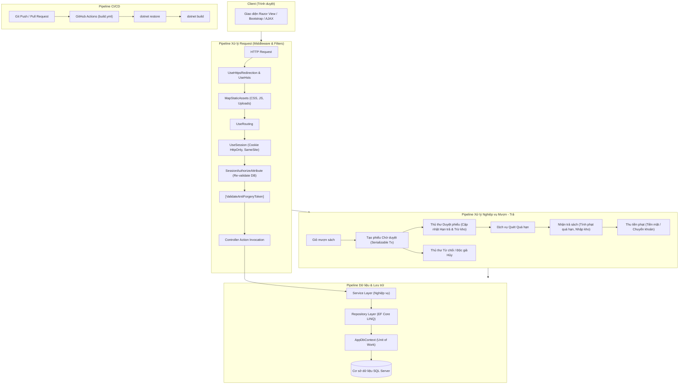
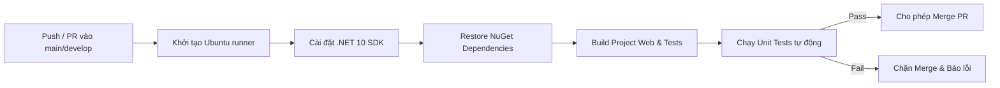
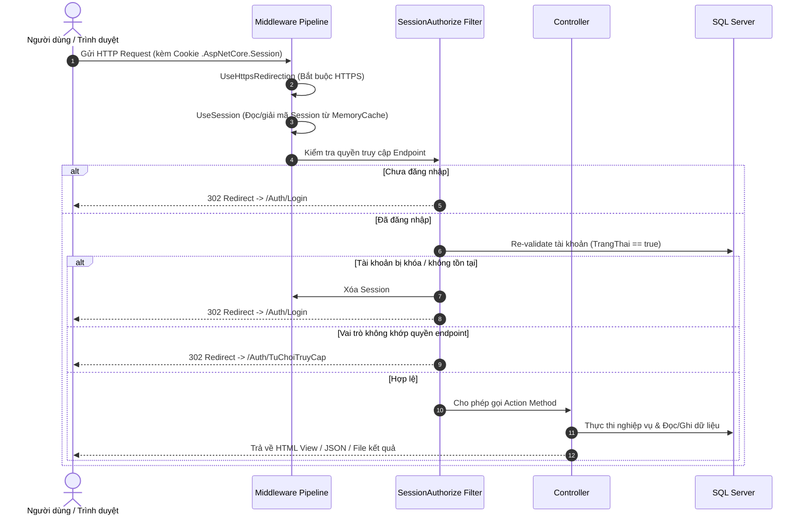
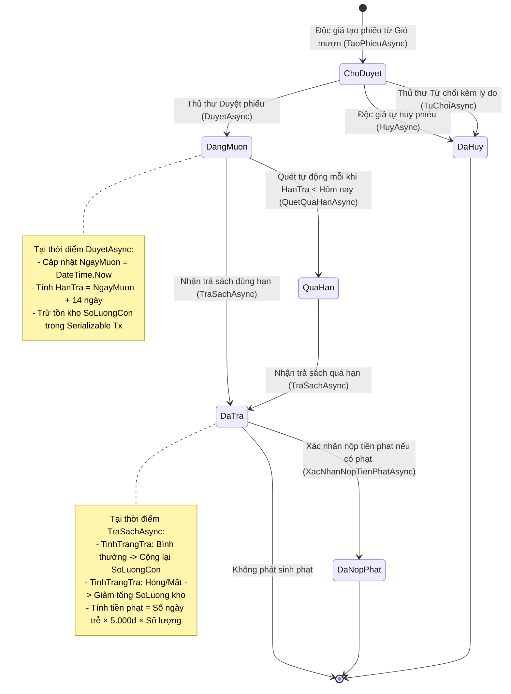

# Mô tả Pipeline Hệ thống - Quản lý Thư viện UNETI

Hệ thống Quản lý Thư viện và Mượn trả sách (Đề tài 14 - Nhóm 01) được xây dựng trên nền tảng **ASP.NET Core 10 MVC**, **Entity Framework Core 10** và **SQL Server**. Tài liệu này mô tả chi tiết các pipeline (đường ống xử lý) chính trong toàn bộ vòng đời của hệ thống.

---

## 1. Tổng quan Kiến trúc Pipeline



---

## 2. Pipeline Tích hợp và Triển khai liên tục (CI/CD Pipeline)

Pipeline tự động hóa được thiết lập thông qua GitHub Actions tại tệp [`.github/workflows/build.yml`](file:///d:/TH_LTNET/HE_THONG_QUAN_LY_THU_VIEN_VA_MUON_TRA_SACH/.github/workflows/build.yml):



### Các bước thực thi:
1. **Trigger**: Kích hoạt tự động khi có commit hoặc Pull Request vào nhánh `main` hoặc `develop`.
2. **Environment Setup**: Thiết lập môi trường Linux runner với .NET 10.
3. **Dependency Restoration**: Phục hồi các package NuGet (`Microsoft.EntityFrameworkCore`, `ClosedXML`...).
4. **Build Verification**: Biên dịch toàn bộ dự án (`dotnet build`) đảm bảo không có lỗi cú pháp hay thiếu thư viện.

---

## 3. Pipeline Xử lý HTTP Request (ASP.NET Core Middleware & Filter Pipeline)

Mỗi yêu cầu từ trình duyệt được chuyển tiếp qua chuỗi Middleware được cấu hình trong [`Program.cs`](file:///d:/TH_LTNET/HE_THONG_QUAN_LY_THU_VIEN_VA_MUON_TRA_SACH/QuanLyThuVien_UNETI01_DHTI17A4HN/Program.cs):



### Chi tiết các lớp bảo vệ:
1. **Session Cookie Hardening**:
   - `Cookie.HttpOnly = true`: Ngăn chặn mã JavaScript độc hại đánh cắp Cookie phiên thông qua tấn công XSS.
   - `Cookie.SameSite = SameSiteMode.Lax`: Ngăn ngừa tấn công Cross-Site Request Forgery (CSRF) đối với session.
   - `IdleTimeout = TimeSpan.FromMinutes(30)`: Tự động kết thúc phiên làm việc sau 30 phút không hoạt động.
2. **Dynamic DB Re-validation (`SessionAuthorizeAttribute`)**:
   - Khi có request gửi đến action được bảo vệ, bộ lọc không chỉ tin cậy vào Session trong RAM mà còn chủ động truy vấn cơ sở dữ liệu để kiểm tra trạng thái kích hoạt của tài khoản.
   - Ngăn chặn triệt để lỗ hổng: tài khoản đã bị Quản trị viên vô hiệu hóa nhưng vẫn giữ phiên làm việc cũ.

---

## 4. Pipeline Nghiệp vụ Mượn - Trả sách (Business Workflow Pipeline)

Quy trình quản lý phiếu mượn tuân theo sơ đồ máy trạng thái nghiêm ngặt:



### Các bước bảo đảm an toàn trong giao dịch mượn trả:
1. **Chống Over-borrowing & Race condition (`TaoPhieuAsync`)**:
   - Quá trình kiểm tra điều kiện mượn (độc giả không quá 5 cuốn, không có sách quá hạn, sách còn phục vụ) và lưu phiếu được bọc trong giao dịch `IsolationLevel.Serializable`.
   - Ngăn ngừa hành vi gửi request song song để mượn vượt số lượng cho phép.
2. **Khắc phục lỗi tính hạn trả (`DuyetAsync`)**:
   - Hạn trả 14 ngày được tính lại chính xác từ **ngày thủ thư bàn giao sách thực tế**, không tính từ ngày độc giả gửi yêu cầu online.
   - Ngăn chặn phạt oan cho độc giả do độ trễ duyệt phiếu của thư viện.
3. **Toàn vẹn tồn kho (`TraSachAsync`)**:
   - Sách bình thường: Cộng hoàn trả vào `SoLuongCon`.
   - Sách hỏng/mất: Giảm tổng số lượng `SoLuong` của đầu sách, giữ nguyên `SoLuongCon`.

---

## 5. Pipeline Xử lý Dữ liệu và Concurrency (Data & Concurrency Pipeline)

Hệ thống áp dụng mô hình **Repository - Service** phân tách độc lập:

```text
[HTTP Request]
       │
       ▼
[Controllers]
       │
       ▼
[Services] ──────────► [Business Validation & Calculation]
       │
       ▼
[Repositories] ──────► [LINQ Query Definition & Projection]
       │
       ▼
[AppDbContext] ──────► [Change Tracker & Unit of Work]
       │
       ▼
[SQL Server Engine] ─► [Foreign Keys, Unique Indexes, Cascades]
```

### Các cơ chế an toàn dữ liệu:
- **Ngăn chặn Cascade Delete nguy hiểm**: `AppDbContext.cs` cấu hình `DeleteBehavior.Restrict` cho toàn bộ các quan hệ `BanDoc -> PhieuMuon`, `Sach -> ChiTietMuon`, `TaiKhoan -> BanDoc`, đảm bảo không bao giờ bị xóa dây chuyền mất dữ liệu lịch sử mượn và tài sản thư viện.
- **Bắt ngoại lệ Unique Constraint (`DbUpdateException`)**: Tại luồng đăng ký tài khoản, việc xung đột trùng tên đăng nhập song song được bắt ngoại lệ và trả thông báo lỗi hợp lệ cho giao diện thay vì lỗi máy chủ 500.

---

## 6. Pipeline Thông báo Email (Notification Pipeline)

Hệ thống tích hợp [`SmtpEmailNotificationService`](file:///d:/TH_LTNET/HE_THONG_QUAN_LY_THU_VIEN_VA_MUON_TRA_SACH/QuanLyThuVien_UNETI01_DHTI17A4HN/Services/Notifications/SmtpEmailNotificationService.cs) để tự động gửi thông báo đến độc giả:

1. **Trigger sự kiện**:
   - Thủ thư phê duyệt phiếu mượn.
   - Thủ thư từ chối phiếu mượn kèm lý do.
   - Thủ thư nhận trả sách và chốt tiền phạt.
2. **Kiểm tra cấu hình**:
   - Nếu SMTP chưa cấu hình, dịch vụ trả về trạng thái `Disabled` an toàn mà không làm gián đoạn hoặc rollback giao dịch mượn trả đã thành công.
   - Giao diện Razor View nhận `TempData["CanhBao"]` để thông báo rõ ràng cho nhân viên biết email chưa được phát đi.
